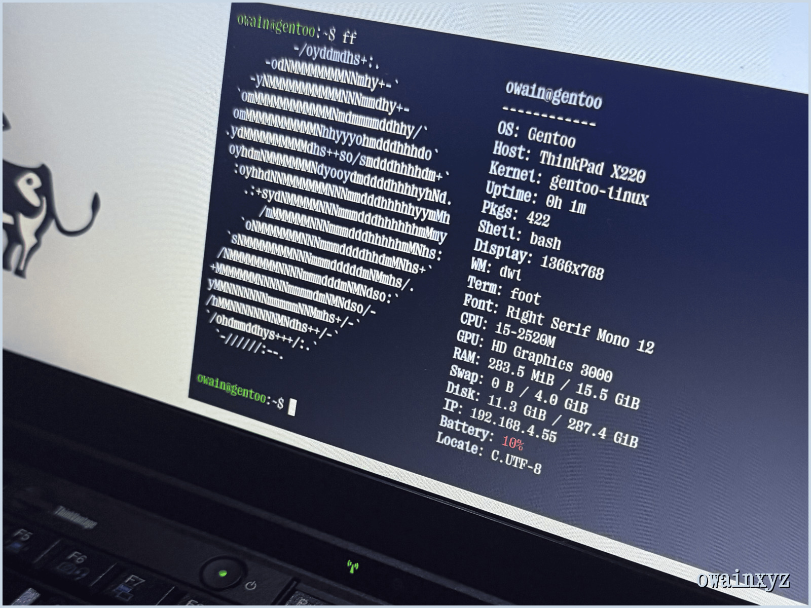

  

  <a href="https://gentoo.lol"><picture><source media="(prefers-color-scheme: light)" srcset="https://img.shields.io/badge/gentoo.lol-f0f2f5?style=for-the-badge&logo=gentoo&logoColor=1f2328&labelColor=f0f2f5"></picture></a>
  <a href="https://huhfloppuh.com"><picture><source media="(prefers-color-scheme: light)" srcset="https://img.shields.io/badge/huhfloppuh.com-f0f2f5?style=for-the-badge&logo=googlechrome&logoColor=1f2328&labelColor=f0f2f5"></picture></a>
  <a href="https://owainxyz.github.io/infopage/"><picture><source media="(prefers-color-scheme: light)" srcset="https://img.shields.io/badge/infopage-f0f2f5?style=for-the-badge&logo=githubpages&logoColor=1f2328&labelColor=f0f2f5"></picture></a>

## about

Python/Nix builder. NixOS daily driver.

  <picture><source media="(prefers-color-scheme: light)" srcset="https://img.shields.io/badge/nix-f0f2f5?style=flat-square&logo=nixos&logoColor=7e7eff"></picture>
  <picture><source media="(prefers-color-scheme: light)" srcset="https://img.shields.io/badge/python-f0f2f5?style=flat-square&logo=python&logoColor=3572A5"></picture>
  <picture><source media="(prefers-color-scheme: light)" srcset="https://img.shields.io/badge/shell-f0f2f5?style=flat-square&logo=gnubash&logoColor=89e051"></picture>
  <picture><source media="(prefers-color-scheme: light)" srcset="https://img.shields.io/badge/c++-f0f2f5?style=flat-square&logo=cplusplus&logoColor=f34b7d"></picture>
  <picture><source media="(prefers-color-scheme: light)" srcset="https://img.shields.io/badge/nixos-f0f2f5?style=flat-square&logo=nixos&logoColor=1f2328"></picture>

## stats

<picture><source media="(prefers-color-scheme: light)" srcset="https://stats.gentoo.lol/light/overview.svg"></picture>

<picture><source media="(prefers-color-scheme: light)" srcset="https://stats.gentoo.lol/light/contributions.svg"></picture>

<picture><source media="(prefers-color-scheme: light)" srcset="https://stats.gentoo.lol/light/languages.svg"></picture>
<picture><source media="(prefers-color-scheme: light)" srcset="https://stats.gentoo.lol/light/recent.svg"></picture>

## contributed to

<a href="https://github.com/search?q=author%3Aowainxyz+is%3Apr+-user%3Aowainxyz&type=pullrequests"><picture><source media="(prefers-color-scheme: light)" srcset="https://stats.gentoo.lol/light/contributed.svg"></picture></a>

## projects

### [uncord](https://github.com/owainxyz/uncord)

Discord in your terminal: voice and video calls, inline images and screen sharing.

<a href="https://github.com/owainxyz/uncord"><picture><source media="(prefers-color-scheme: light)" srcset="https://stats.gentoo.lol/light/uncord.svg"></picture></a>

### [shortleash](https://github.com/owainxyz/shortleash)

Timed, logged root for AI agents: you open a window, the agent runs commands through it, it shuts itself.

### configs

| repo | |
| --- | --- |
| [waybar-config](https://github.com/owainxyz/waybar-config) | two plain dark grey bars for hyprland, sway, niri, river and dwl |
| [fastfetch-config](https://github.com/owainxyz/fastfetch-config) | custom fastfetch theme |
| [collection-of-wallpapers](https://github.com/owainxyz/collection-of-wallpapers) | 79 wallpapers: gradients, photography, flowers, with previews |

