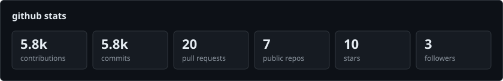
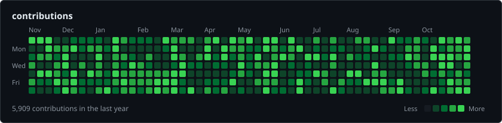
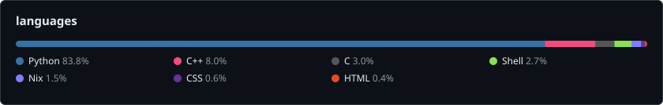
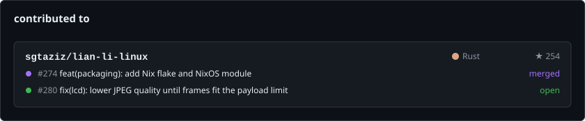
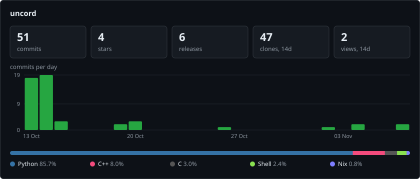
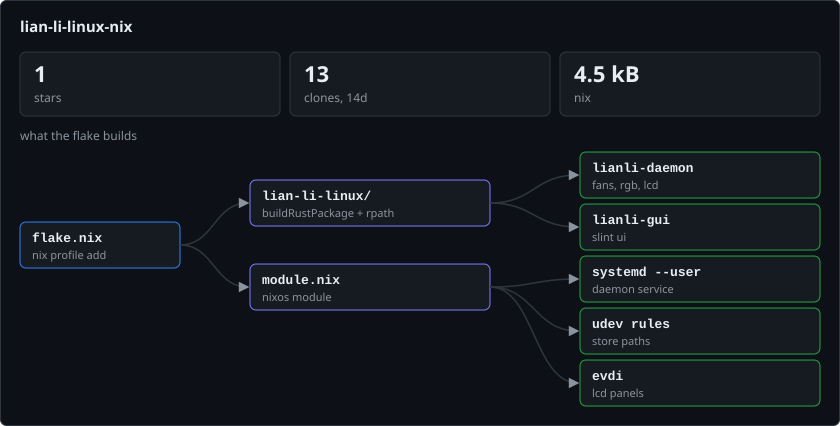

<p align="center">
  
</p>

<p align="center">
  <a href="https://gentoo.lol"></a>
  <a href="https://huhfloppuh.com"></a>
  <a href="https://owainxyz.github.io/infopage/"></a>
</p>

## about

Python/Nix builder. NixOS daily driver.

<p>
  
  
  
  
  
</p>

## stats







## contributed to

<a href="https://github.com/search?q=author%3Aowainxyz+is%3Apr+-user%3Aowainxyz&type=pullrequests"></a>

## projects

### [uncord](https://github.com/owainxyz/uncord)

Discord in your terminal: voice and video calls, inline images and screen sharing.

<a href="https://github.com/owainxyz/uncord"></a>

### [lian-li-linux-nix](https://github.com/owainxyz/lian-li-linux-nix)

NixOS packaging for [lian-li-linux](https://github.com/sgtaziz/lian-li-linux): fans, RGB and LCD control for Lian Li hardware. Merged upstream in 1.2.5.

```sh
nix profile add github:sgtaziz/lian-li-linux
```

<a href="https://github.com/owainxyz/lian-li-linux-nix"></a>

### configs

| repo | |
| --- | --- |
| [waybar-config](https://github.com/owainxyz/waybar-config) | two plain dark grey bars for hyprland, sway, niri, river and dwl |
| [fastfetch-config](https://github.com/owainxyz/fastfetch-config) | custom fastfetch theme |
| [collection-of-wallpapers](https://github.com/owainxyz/collection-of-wallpapers) | wallpapers |

